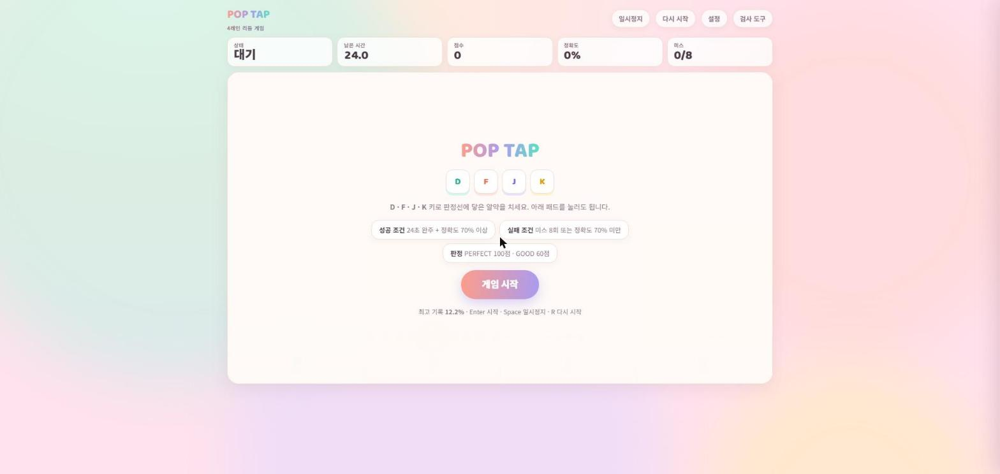
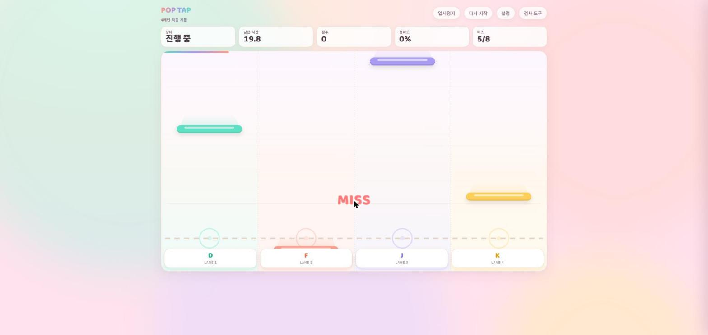
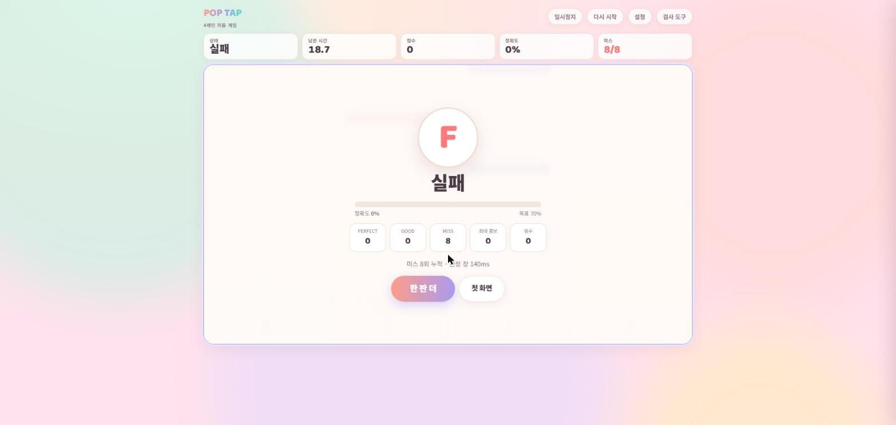

# POP TAP — 4레인 리듬 게임

24초짜리 미니 리듬 게임입니다.



**데모**: https://alpeh-second-mini-game.vercel.app/

## 조작법

- `D` `F` `J` `K` : 1~4번 레인 타격
- `Enter` : 게임 시작 (대기 상태일 때)
- `Space` : 일시정지 / 재개
- `R` : 재시작
- `Esc` : 패널 닫기

화면 하단의 패드를 클릭해도 동일하게 동작합니다.



## 규칙

- 트랙 길이 24초, 고정 시드로 생성된 49개 노트 — 매 판 동일한 패턴
- 판정: `PERFECT`(+100) / `GOOD`(+60) / `MISS`(0점, 콤보 초기화)
- 판정창 기본값 140ms, 설정에서 60~240ms로 조절 가능
- 실패 조건: 미스 8회 누적
- 통과 조건: 24초 완주 + 정확도 70% 이상
- 통과 시 랭크: S(95%↑) / A(88%↑) / B(79%↑) / C(그 외)



## 기능

- Web Audio API 기반 판정 효과음 (PERFECT/GOOD 음 높이 구분, 통과 시 2음 징글)
- 콤보 · 파티클 · 점수 팝업 이펙트 — "움직임 감소" 옵션으로 끌 수 있음
- `localStorage`에 최고 기록과 최근 플레이 기록(최대 60개) 저장
- 검사 도구 패널: 기록 테이블 조회, CSV 내보내기, 기록 초기화
- 음소거 옵션, 탭 비활성화 시 자동 일시정지

## 기술 스택

- 순수 HTML / CSS / JavaScript — 프레임워크, 빌드 도구, 외부 의존성 없음
- 단일 파일(`index.html`)에 폰트까지 base64로 인라인 처리 → 외부 네트워크 요청 없음
- Web Audio API, Pointer Events, `localStorage`, Blob 다운로드(CSV)

## 실행 방법

빌드 과정 없이 `index.html`을 브라우저로 바로 열면 됩니다. 정적 파일 서버로 서빙해도 됩니다:

```
npx serve .
```

## 배포

Vercel에 정적 사이트로 배포되어 있습니다.
